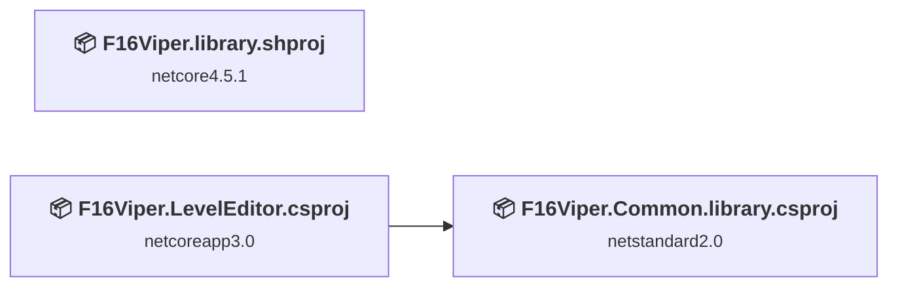
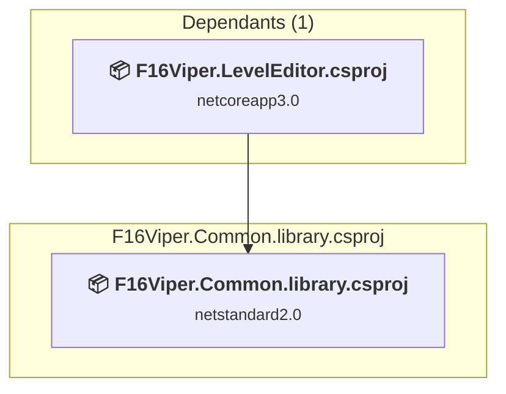
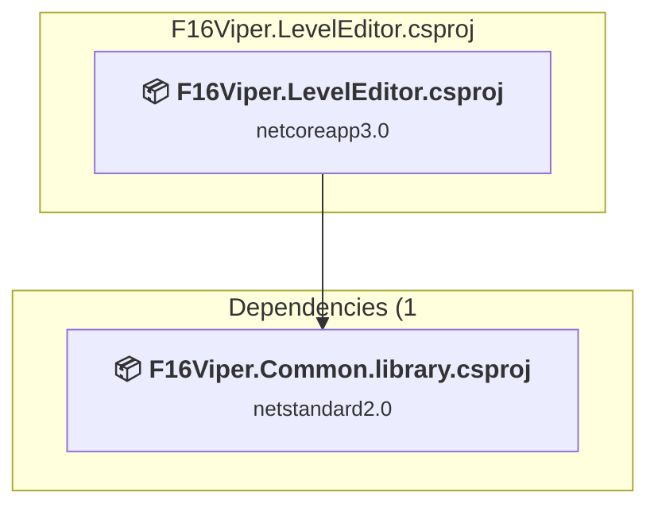
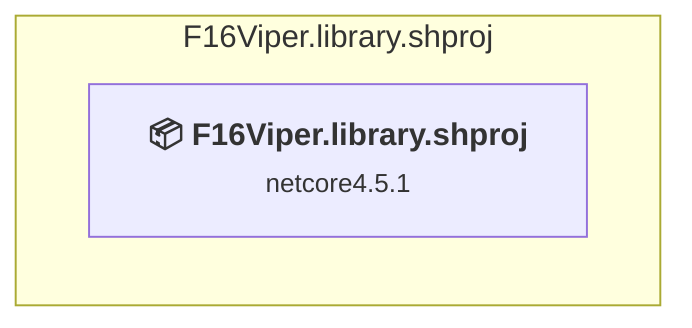

# Projects and dependencies analysis

This document provides a comprehensive overview of the projects and their dependencies in the context of upgrading to .NETCoreApp,Version=v10.0.

## Table of Contents

- [Executive Summary](#executive-Summary)
  - [Highlevel Metrics](#highlevel-metrics)
  - [Projects Compatibility](#projects-compatibility)
  - [Package Compatibility](#package-compatibility)
  - [API Compatibility](#api-compatibility)
- [Aggregate NuGet packages details](#aggregate-nuget-packages-details)
- [Top API Migration Challenges](#top-api-migration-challenges)
  - [Technologies and Features](#technologies-and-features)
  - [Most Frequent API Issues](#most-frequent-api-issues)
- [Projects Relationship Graph](#projects-relationship-graph)
- [Project Details](#project-details)

  - [F16Viper.Common.library\F16Viper.Common.library.csproj](#f16vipercommonlibraryf16vipercommonlibrarycsproj)
  - [F16Viper.LevelEditor\F16Viper.LevelEditor.csproj](#f16viperleveleditorf16viperleveleditorcsproj)
  - [F16Viper.library\F16Viper.library.shproj](#f16viperlibraryf16viperlibraryshproj)

## Executive Summary

### Highlevel Metrics

| Metric | Count | Status |
| :--- | :---: | :--- |
| Total Projects | 3 | 2 require upgrade |
| Total NuGet Packages | 2 | All compatible |
| Total Code Files | 16 |  |
| Total Code Files with Incidents | 6 |  |
| Total Lines of Code | 820 |  |
| Total Number of Issues | 65 |  |
| Estimated LOC to modify | 63+ | at least 7.7% of codebase |

### Projects Compatibility

| Project | Target Framework | Difficulty | Package Issues | API Issues | Est. LOC Impact | Description |
| :--- | :---: | :---: | :---: | :---: | :---: | :--- |
| [F16Viper.Common.library\F16Viper.Common.library.csproj](#f16vipercommonlibraryf16vipercommonlibrarycsproj) | netstandard2.0 | ✅ None | 0 | 0 |  | ClassLibrary, Sdk Style = True |
| [F16Viper.LevelEditor\F16Viper.LevelEditor.csproj](#f16viperleveleditorf16viperleveleditorcsproj) | netcoreapp3.0 | 🟡 Medium | 0 | 63 | 63+ | Wpf, Sdk Style = True |
| [F16Viper.library\F16Viper.library.shproj](#f16viperlibraryf16viperlibraryshproj) | netcore4.5.1 | 🟢 Low | 0 | 0 |  | DotNetCoreApp, Sdk Style = True |

### Package Compatibility

| Status | Count | Percentage |
| :--- | :---: | :---: |
| ✅ Compatible | 2 | 100.0% |
| ⚠️ Incompatible | 0 | 0.0% |
| 🔄 Upgrade Recommended | 0 | 0.0% |
| ***Total NuGet Packages*** | ***2*** | ***100%*** |

### API Compatibility

| Category | Count | Impact |
| :--- | :---: | :--- |
| 🔴 Binary Incompatible | 58 | High - Require code changes |
| 🟡 Source Incompatible | 0 | Medium - Needs re-compilation and potential conflicting API error fixing |
| 🔵 Behavioral change | 5 | Low - Behavioral changes that may require testing at runtime |
| ✅ Compatible | 237 |  |
| ***Total APIs Analyzed*** | ***300*** |  |

## Aggregate NuGet packages details

| Package | Current Version | Suggested Version | Projects | Description |
| :--- | :---: | :---: | :--- | :--- |
| NETStandard.Library | 2.0.3 |  | [F16Viper.Common.library.csproj](#f16vipercommonlibraryf16vipercommonlibrarycsproj) | ✅Compatible |
| Newtonsoft.Json | 13.0.4 |  | [F16Viper.Common.library.csproj](#f16vipercommonlibraryf16vipercommonlibrarycsproj) | ✅Compatible |

## Top API Migration Challenges

### Technologies and Features

| Technology | Issues | Percentage | Migration Path |
| :--- | :---: | :---: | :--- |
| WPF (Windows Presentation Foundation) | 24 | 38.1% | WPF APIs for building Windows desktop applications with XAML-based UI that are available in .NET on Windows. WPF provides rich desktop UI capabilities with data binding and styling. Enable Windows Desktop support: Option 1 (Recommended): Target net9.0-windows; Option 2: Add <UseWindowsDesktop>true</UseWindowsDesktop>. |

### Most Frequent API Issues

| API | Count | Percentage | Category |
| :--- | :---: | :---: | :--- |
| T:System.Windows.RoutedEventHandler | 12 | 19.0% | Binary Incompatible |
| T:System.Windows.Controls.ListView | 6 | 9.5% | Binary Incompatible |
| T:System.Windows.RoutedEventArgs | 6 | 9.5% | Binary Incompatible |
| E:System.Windows.Controls.MenuItem.Click | 5 | 7.9% | Binary Incompatible |
| T:System.Windows.Application | 4 | 6.3% | Binary Incompatible |
| T:System.Uri | 3 | 4.8% | Behavioral Change |
| T:System.Windows.Controls.MenuItem | 3 | 4.8% | Binary Incompatible |
| P:System.Windows.FrameworkElement.DataContext | 3 | 4.8% | Binary Incompatible |
| M:System.Uri.#ctor(System.String,System.UriKind) | 2 | 3.2% | Behavioral Change |
| T:System.Windows.Controls.ContextMenu | 2 | 3.2% | Binary Incompatible |
| M:System.Windows.Window.#ctor | 2 | 3.2% | Binary Incompatible |
| M:System.Windows.Application.Run | 1 | 1.6% | Binary Incompatible |
| P:System.Windows.Application.StartupUri | 1 | 1.6% | Binary Incompatible |
| M:System.Windows.Application.#ctor | 1 | 1.6% | Binary Incompatible |
| E:System.Windows.Controls.Primitives.ButtonBase.Click | 1 | 1.6% | Binary Incompatible |
| M:System.Windows.Application.LoadComponent(System.Object,System.Uri) | 1 | 1.6% | Binary Incompatible |
| P:System.Windows.Controls.Primitives.Selector.SelectedItem | 1 | 1.6% | Binary Incompatible |
| M:System.Windows.Controls.ListBox.ScrollIntoView(System.Object) | 1 | 1.6% | Binary Incompatible |
| T:System.Windows.Controls.ItemCollection | 1 | 1.6% | Binary Incompatible |
| P:System.Windows.Controls.ItemsControl.Items | 1 | 1.6% | Binary Incompatible |
| P:System.Windows.Controls.ItemCollection.Count | 1 | 1.6% | Binary Incompatible |
| P:System.Windows.Controls.Primitives.Selector.SelectedIndex | 1 | 1.6% | Binary Incompatible |
| P:System.Windows.Application.Current | 1 | 1.6% | Binary Incompatible |
| M:System.Windows.Application.Shutdown | 1 | 1.6% | Binary Incompatible |
| T:System.Windows.Markup.IComponentConnector | 1 | 1.6% | Binary Incompatible |
| T:System.Windows.Window | 1 | 1.6% | Binary Incompatible |

## Projects Relationship Graph

Legend:
📦 SDK-style project
⚙️ Classic project

## Project Details

### F16Viper.Common.library\F16Viper.Common.library.csproj

#### Project Info

- **Current Target Framework:** netstandard2.0✅
- **SDK-style**: True
- **Project Kind:** ClassLibrary
- **Dependencies**: 0
- **Dependants**: 1
- **Number of Files**: 2
- **Lines of Code**: 41
- **Estimated LOC to modify**: 0+ (at least 0.0% of the project)

#### Dependency Graph

Legend:
📦 SDK-style project
⚙️ Classic project

### API Compatibility

| Category | Count | Impact |
| :--- | :---: | :--- |
| 🔴 Binary Incompatible | 0 | High - Require code changes |
| 🟡 Source Incompatible | 0 | Medium - Needs re-compilation and potential conflicting API error fixing |
| 🔵 Behavioral change | 0 | Low - Behavioral changes that may require testing at runtime |
| ✅ Compatible | 41 |  |
| ***Total APIs Analyzed*** | ***41*** |  |

### F16Viper.LevelEditor\F16Viper.LevelEditor.csproj

#### Project Info

- **Current Target Framework:** netcoreapp3.0
- **Proposed Target Framework:** net10.0-windows
- **SDK-style**: True
- **Project Kind:** Wpf
- **Dependencies**: 1
- **Dependants**: 0
- **Number of Files**: 3
- **Number of Files with Incidents**: 5
- **Lines of Code**: 289
- **Estimated LOC to modify**: 63+ (at least 21.8% of the project)

#### Dependency Graph

Legend:
📦 SDK-style project
⚙️ Classic project

### API Compatibility

| Category | Count | Impact |
| :--- | :---: | :--- |
| 🔴 Binary Incompatible | 58 | High - Require code changes |
| 🟡 Source Incompatible | 0 | Medium - Needs re-compilation and potential conflicting API error fixing |
| 🔵 Behavioral change | 5 | Low - Behavioral changes that may require testing at runtime |
| ✅ Compatible | 196 |  |
| ***Total APIs Analyzed*** | ***259*** |  |

#### Project Technologies and Features

| Technology | Issues | Percentage | Migration Path |
| :--- | :---: | :---: | :--- |
| WPF (Windows Presentation Foundation) | 24 | 38.1% | WPF APIs for building Windows desktop applications with XAML-based UI that are available in .NET on Windows. WPF provides rich desktop UI capabilities with data binding and styling. Enable Windows Desktop support: Option 1 (Recommended): Target net9.0-windows; Option 2: Add <UseWindowsDesktop>true</UseWindowsDesktop>. |

### F16Viper.library\F16Viper.library.shproj

#### Project Info

- **Current Target Framework:** netcore4.5.1
- **Proposed Target Framework:** net10.0
- **SDK-style**: True
- **Project Kind:** DotNetCoreApp
- **Dependencies**: 0
- **Dependants**: 0
- **Number of Files**: 11
- **Number of Files with Incidents**: 1
- **Lines of Code**: 490
- **Estimated LOC to modify**: 0+ (at least 0.0% of the project)

#### Dependency Graph

Legend:
📦 SDK-style project
⚙️ Classic project

### API Compatibility

| Category | Count | Impact |
| :--- | :---: | :--- |
| 🔴 Binary Incompatible | 0 | High - Require code changes |
| 🟡 Source Incompatible | 0 | Medium - Needs re-compilation and potential conflicting API error fixing |
| 🔵 Behavioral change | 0 | Low - Behavioral changes that may require testing at runtime |
| ✅ Compatible | 0 |  |
| ***Total APIs Analyzed*** | ***0*** |  |

